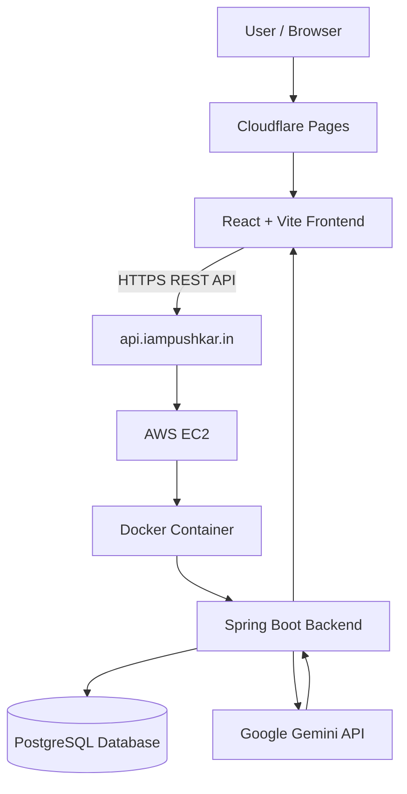

# HireMind – AI-Powered Job Portal

<p align="center">
  
</p>

<h3 align="center">Think. Apply. Thrive.</h3>

<p align="center">
  An intelligent job discovery and career management platform powered by AI.
</p>

<p align="center">
  <a href="https://hiremind.iampushkar.in">Live Application</a> •
  <a href="https://github.com/PushkarVishwakarma01/HireMind">Frontend Repository</a> •
  <a href="https://github.com/PushkarVishwakarma01/hiremind-backend">Backend Repository</a>
</p>

---

## 🚀 Overview

**HireMind** is an AI-powered job portal designed to simplify and improve the job search experience. It helps job seekers discover relevant opportunities, manage applications, analyze resumes, and make smarter career decisions.

Unlike traditional job portals, HireMind integrates AI-driven capabilities to assist candidates throughout their job search journey.

The platform combines a modern web interface, a Spring Boot backend, database management, and AI-powered services to provide an integrated career management experience.

**Live Demo:** https://hiremind.iampushkar.in

---

## ✨ Key Features

### 1. Intelligent Job Discovery
- Browse and explore available job opportunities.
- Search jobs by title, company, and skills.
- Filter opportunities based on relevant criteria.
- Discover opportunities that match your career interests.

### 2. AI Job Recommendations
- AI-powered job recommendation functionality.
- Discover opportunities based on relevant skills and career interests.
- Reduce the effort required to find relevant job openings.

### 3. AI Resume Analyzer (ATS)
- Analyze resumes using AI.
- Generate an ATS compatibility score.
- Identify matched and missing skills.
- Evaluate resume content against job requirements.
- Receive suggestions to improve resume quality.

### 4. Application Management
- Track applied jobs.
- Manage job application information.
- Keep career opportunities organized.
- Monitor the application process.

### 5. User Authentication and Security
- User registration and login.
- OAuth-based authentication support.
- Secure backend API architecture.
- Authentication and registration audit logging.

### 6. Career Resources and Communication
- Dedicated resources section.
- Messaging interface.
- Centralized career management dashboard.

---

## 🛠️ Technology Stack

### Frontend
- React.js
- JavaScript
- HTML5
- CSS3
- Tailwind CSS
- Vite

### Backend
- Java
- Spring Boot
- Spring Security
- RESTful APIs
- Maven

### Database
- PostgreSQL

### AI Integration
- Google Gemini API
- AI-powered resume analysis
- ATS scoring and skill matching
- Intelligent job recommendation functionality

### DevOps and Deployment
- Git and GitHub
- Docker
- Docker Compose
- AWS EC2
- AWS RDS (previous database deployment architecture)
- Cloudflare Pages
- Cloudflare DNS
- Linux

---

## 🏗️ System Architecture

HireMind follows a frontend-backend architecture in which the frontend communicates with the backend through REST APIs.



### Architecture Components

**1. Frontend – Cloudflare Pages**

The React frontend is hosted on Cloudflare Pages and is accessible through:

https://hiremind.iampushkar.in

Cloudflare provides frontend hosting, HTTPS, and DNS management.

**2. Backend – AWS EC2**

The backend is developed using Spring Boot and packaged as a Docker container.

The intended production deployment uses an AWS EC2 instance to host the backend application.

Backend API domain:

https://api.iampushkar.in

**3. Database – PostgreSQL**

PostgreSQL is used for persistent application data, including user and job-related information.

The previous deployment architecture used AWS RDS. The database configuration will be finalized as part of the new AWS deployment.

**4. AI Integration – Google Gemini**

Google Gemini API is integrated for AI-powered capabilities such as resume analysis and intelligent career assistance.

---

## ☁️ Deployment Architecture

HireMind uses a distributed deployment architecture.

| Component | Platform | Purpose |
|---|---|---|
| Frontend | Cloudflare Pages | Hosting React application |
| Frontend Domain | Cloudflare DNS | Custom domain management |
| Backend | AWS EC2 | Hosting Spring Boot application |
| Containerization | Docker | Backend packaging and deployment |
| Database | PostgreSQL | Persistent data storage |
| AI Services | Google Gemini | AI-powered functionality |
| API Communication | HTTPS REST APIs | Frontend-backend integration |

### Deployment Flow

1. The user accesses HireMind through the custom frontend domain.
2. Cloudflare serves the React application.
3. The frontend sends API requests to the backend domain.
4. Requests are processed by the Spring Boot application running inside Docker.
5. The backend communicates with PostgreSQL when database operations are required.
6. AI-related requests are processed through the Gemini API.
7. Responses are returned to the frontend.

**Deployment status:** The frontend is currently hosted on Cloudflare Pages. The previous backend deployment used AWS infrastructure. Backend redeployment and API endpoint verification on the new AWS account are in progress.

---

## 📂 Project Structure

The consolidated repository is organized as follows:

```text
HireMind-FullStack/
│
├── frontend/
│   ├── public/
│   ├── src/
│   │   ├── components/
│   │   ├── pages/
│   │   ├── services/
│   │   └── ...
│   ├── package.json
│   └── vite.config.js
│
├── backend/
│   ├── src/
│   │   ├── main/
│   │   │   ├── java/
│   │   │   └── resources/
│   │   └── test/
│   ├── pom.xml
│   ├── Dockerfile
│   └── docker-compose.yml
│
├── README.md
└── .gitignore
```

*The directory structure represents the intended consolidated repository. Actual folders may differ depending on the existing source code.*

---

## ⚙️ Getting Started

Follow these instructions to run HireMind locally.

### Prerequisites

Install the following:

- Node.js and npm
- Java JDK
- Maven
- PostgreSQL
- Git
- Docker (optional)

### 1. Clone the Repository

```bash
git clone https://github.com/PushkarVishwakarma01/HireMind-FullStack.git

cd HireMind-FullStack
```

### 2. Setup Frontend

```bash
cd frontend

npm install
```

Create a `.env` file in the frontend directory:

```env
VITE_API_BASE_URL=http://localhost:8080
```

Start the development server:

```bash
npm run dev
```

Frontend will be available at:

```text
http://localhost:5173
```

### 3. Setup Backend

Open another terminal:

```bash
cd backend
```

Configure your backend environment variables and database connection.

Example configuration:

```properties
spring.datasource.url=${DATABASE_URL}
spring.datasource.username=${DB_USERNAME}
spring.datasource.password=${DB_PASSWORD}

# Configure your Gemini API key securely
GEMINI_API_KEY=${GEMINI_API_KEY}
```

The exact configuration should match the application's existing Spring Boot properties and environment-variable names.

Run the application:

```bash
./mvnw spring-boot:run
```

On Windows:

```bash
mvnw.cmd spring-boot:run
```

Backend will be available at:

```text
http://localhost:8080
```

### 4. Run Using Docker

If Docker configuration is available:

```bash
cd backend

docker build -t hiremind-backend .
```

Run the container:

```bash
docker run -p 8080:8080 hiremind-backend
```

For the complete application, configure PostgreSQL and the required environment variables before starting the container.

---

## 🔐 Environment Variables

Do not commit secrets or credentials to GitHub.

Typical configuration includes:

| Variable | Description |
|---|---|
| DATABASE_URL | PostgreSQL connection URL |
| DB_USERNAME | Database username |
| DB_PASSWORD | Database password |
| GEMINI_API_KEY | Google Gemini API key |
| JWT_SECRET | Authentication signing secret, if applicable |
| VITE_API_BASE_URL | Frontend API base URL |

Use environment-specific configuration for local development and production.

---

## 🔒 Security Considerations

- Never expose API keys or database credentials.
- Keep production secrets outside the source repository.
- Use HTTPS for production communication.
- Restrict database access to trusted services.
- Configure appropriate CORS policies.
- Do not commit `.env` files.

---

## 🚀 Future Improvements

- Advanced AI-powered career recommendations.
- More personalized resume optimization.
- Interview preparation and AI mock interviews.
- Real-time application status updates.
- Advanced job matching algorithms.
- Employer and recruiter dashboards.
- Improved analytics and career insights.

---

## 👨‍💻 Author

**Pushkar Vishwakarma**

B.Tech – Computer Science and Engineering

- GitHub: https://github.com/PushkarVishwakarma01
- Portfolio: https://hiremind.iampushkar.in
- Project: HireMind

---

## 📄 License

This project is intended for educational and portfolio demonstration purposes. A formal license can be added to define reuse and distribution permissions.

---

<p align="center">
  <b>HireMind – Think. Apply. Thrive.</b>
  <br/>
  Making career opportunities smarter with technology and AI.
</p>
